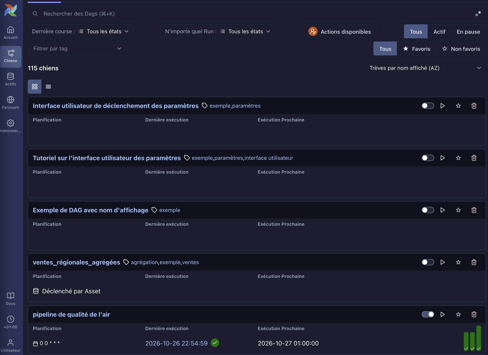
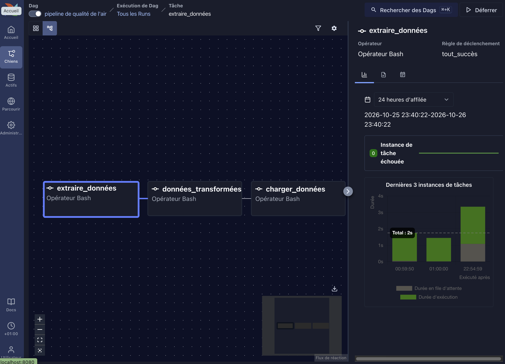
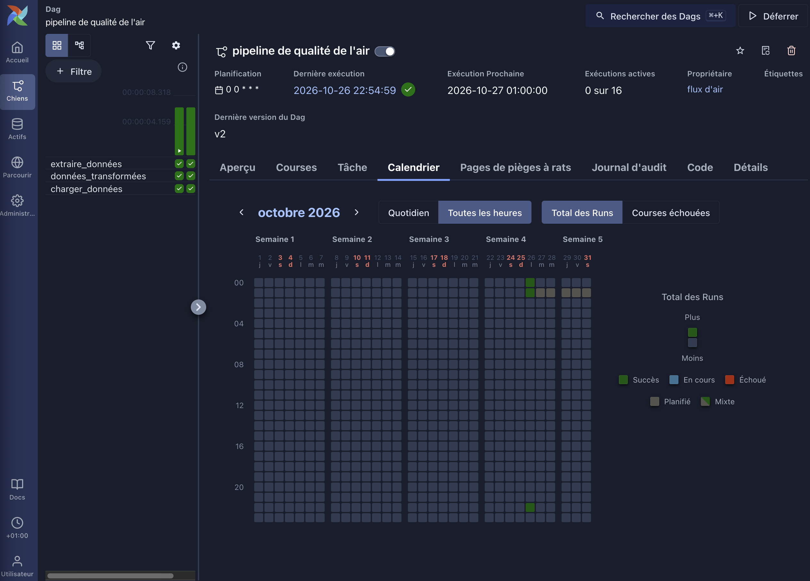
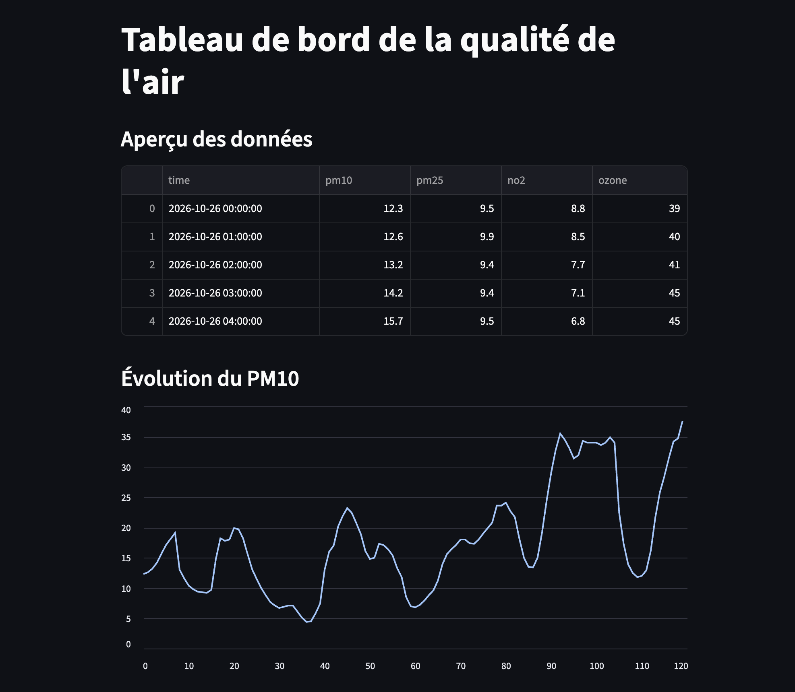

# Air Quality ETL Pipeline with Apache Airflow

## Overview

This project is an end-to-end ETL (Extract, Transform, Load) pipeline for air quality data.

The pipeline automatically:

- Extracts air quality data from an API
- Cleans and transforms the data using Pandas
- Loads the processed data into a SQLite database
- Automates the workflow with Apache Airflow
- Visualizes results through a Streamlit dashboard

---

## Technologies

- Python
- Pandas
- SQLite
- SQL
- Apache Airflow
- Streamlit
- Docker
- Git & GitHub

---

## Architecture

```text
Air Quality API
       |
       v
   Extract
       |
       v
   Transform
       |
       v
     Load
       |
       v
 SQLite Database
       |
       v
Streamlit Dashboard
```

---

## Project Structure

```text
air-quality-pipeline/
│
├── dags/
│   └── air_quality_dag.py
│
├── scripts/
│   ├── extract.py
│   ├── transform.py
│   └── load.py
│
├── dashboard/
│   └── app.py
│
├── sql/
│   └── create_tables.sql
│
├── Screenshots1/
│   ├── airflow-dashboard.png
│   ├── airflow-graph-view.png
│   ├── airflow-grid-view.png
│   └── streamlit-dashboard.png
│
├── air_quality_raw.csv
├── air_quality_clean.csv
├── requirements.txt
├── docker-compose.yml
└── README.md
```

---

# Airflow Dashboard



Apache Airflow dashboard used to monitor ETL executions and manage workflow scheduling.

---

# Airflow Graph View



Graph representation of the ETL workflow showing:

- Extract Data
- Transform Data
- Load Data

All tasks completed successfully.

---

# Airflow Grid View



Execution history showing successful workflow runs.

---

# Streamlit Dashboard



Interactive dashboard displaying air quality indicators and PM10 trends.

---

## Features

- Automated ETL pipeline
- Data cleaning and transformation
- Workflow orchestration with Apache Airflow
- SQLite data storage
- Interactive Streamlit dashboard
- Reproducible Data Engineering workflow

---

## Installation

```bash
git clone https://github.com/Alpha38diallo/air-quality-pipeline.git

cd air-quality-pipeline

python -m venv venv

source venv/bin/activate

pip install -r requirements.txt
```

---

## Run Airflow

```bash
airflow standalone
```

Open:

```text
http://localhost:8080
```

---

## Run Streamlit

```bash
streamlit run dashboard/app.py
```

Open:

```text
http://localhost:8501
```

---

## GitHub Repository

Repository:

https://github.com/Alpha38diallo/air-quality-pipeline

---

## Future Improvements

- PostgreSQL integration
- Data validation tests
- Cloud deployment
- Azure Data Factory integration
- Real-time ingestion pipeline
- CI/CD automation

---

## Author

**Alpha Diallo**

Aspiring Data Engineer | Data Analyst | Python Developer

GitHub:
https://github.com/Alpha38diallo